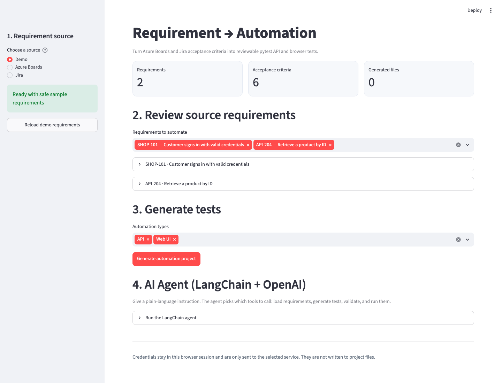

# Requirement to Automation

**Turn acceptance criteria into reviewable API and browser test scaffolds.**

Requirement to Automation connects Azure Boards and Jira requirements to a Python
test-generation workflow. Use the Streamlit interface to review requirements,
generate pytest and Playwright starter tests, edit the output, and download a test
project. An optional LangChain + OpenAI agent orchestrates the same tools through
natural-language instructions.

> **Project status:** Prototype for human-reviewed test generation. Generated tests
> are starting points, not complete acceptance-criteria coverage or production-ready
> automation. A Visual Studio/Nexus plugin is not currently included.

## UI preview



*Actual application screenshot captured in demo mode. No service credentials are
required to explore this workflow.*

## Key capabilities

| Capability | What is available |
| --- | --- |
| Requirement sources | Built-in demo data, Azure Boards via WIQL, and Jira via JQL |
| Criteria parsing | HTML cleanup for Azure fields and Atlassian Document Format conversion for Jira |
| API test scaffolds | pytest + Requests GET tests with status, JSON, and selected field checks |
| Browser test scaffolds | pytest + Playwright navigation and placeholder page assertions |
| Review and export | In-browser code editing, basic static validation, individual scripts, and ZIP downloads |
| Demo execution | Run generated API tests against `dummyjson.com` after confirmation in the UI |
| Optional AI agent | Tool orchestration for loading requirements, generation, validation, and demo execution |

The standard Generate button uses deterministic templates; it does not require an
OpenAI API key. The optional agent uses an OpenAI model to choose and invoke tools,
not to implement arbitrary application-specific test logic.

## Quick start

### Prerequisites

- Python 3.10 or newer; the local development environment used Python 3.13.
- Git and a Python virtual environment.
- Internet access for dependency installation and external integrations.
- Azure/Jira credentials only when connecting to those services.
- An OpenAI API key only when using the optional agent; model usage may incur charges.

### Install and launch

```bash
git clone https://github.com/pkchat55/AC_To_Automation.git
cd AC_To_Automation
python -m venv .venv
```

Activate the environment:

```bash
# macOS / Linux
source .venv/bin/activate
```

```powershell
# Windows PowerShell
.\.venv\Scripts\Activate.ps1
```

Install dependencies and launch the UI:

```bash
python -m pip install -r requirements.txt
python -m streamlit run app.py
```

Open the local URL printed by Streamlit, normally `http://localhost:8501`.

## Using the application

1. **Choose a source.** Start with Demo, or connect to Azure Boards or Jira.
2. **Review requirements.** Inspect descriptions and acceptance criteria, then select
   the requirements you want to automate.
3. **Generate starter tests.** Choose API, Web UI, or both.
4. **Review and edit.** Replace placeholder routes, selectors, test data, and
   assertions. Apply edits before downloading a ZIP project.
5. **Export.** Download an individual script, a type-specific archive, or the full
   pytest project.
6. **Run deliberately.** The UI's demo runner targets `https://dummyjson.com`, not
   your application's API.

### Connect to Azure Boards or Jira

| Source | Required inputs |
| --- | --- |
| Azure Boards | Organization name, project, personal access token, and WIQL query |
| Jira | Site URL, account email, API token, and JQL query |

Use credentials with read access to the relevant work items or issues. For Jira,
you can provide an acceptance-criteria custom field ID such as `customfield_10042`.
If omitted, the description is used as the criteria source. Connectors request up
to 25 items by default.

### Optional AI agent

The UI includes an expandable **AI Agent (LangChain + OpenAI)** section. Enter an
OpenAI API key, choose a model, and provide an instruction.

You can also run the agent from the command line:

```bash
# macOS / Linux
export OPENAI_API_KEY="your-openai-api-key"
```

```powershell
# Windows PowerShell
$env:OPENAI_API_KEY = "your-openai-api-key"
```

```bash
python agent_cli.py "Load the demo requirements and generate API and Playwright UI tests. Do not run them." --output-dir generated_project
```

The default model is `gpt-4o-mini`; override it with `--model`. The CLI saves
generated files to `generated_project` unless a different directory is specified.
Existing files with matching names are overwritten. Running the CLI without an
instruction uses a default workflow that also requests demo API test execution.

## Run exported tests

Extract a full project ZIP and open a terminal in its root:

```bash
python -m pip install -r requirements.txt
python -m playwright install chromium
```

After reviewing and adapting the scripts, configure your targets:

```bash
# macOS / Linux
export TARGET_API_URL="https://your-api.example"
export TARGET_WEB_URL="https://your-app.example"
```

```powershell
# Windows PowerShell
$env:TARGET_API_URL = "https://your-api.example"
$env:TARGET_WEB_URL = "https://your-app.example"
```

```bash
python -m pytest -m "not ui" -v
python -m pytest -m ui -v
```

API scripts default to `https://dummyjson.com` if `TARGET_API_URL` is unset.
Browser scripts skip when `TARGET_WEB_URL` is unset. Browser scaffolds initially
check for the requirement title in the page body; replace this broad assertion
with stable selectors and meaningful behavior checks.

## Architecture

```text
Streamlit UI / Agent CLI
          |
          +-- Optional LangChain + OpenAI orchestration
          |
Azure Boards / Jira / Demo
          |
     Requirement model
          |
   Template-based generation
          |
   Review + basic validation
          |
   Python scripts / ZIP project / Demo API runner
```

| Location | Responsibility |
| --- | --- |
| [app.py](app.py) | Streamlit interface, review, downloads, and demo execution |
| [agent_cli.py](agent_cli.py) | Command-line agent entry point |
| [reqauto/agent.py](reqauto/agent.py) | LangChain tools and agent orchestration |
| [reqauto/connectors.py](reqauto/connectors.py) | Azure/Jira retrieval and requirement mapping |
| [reqauto/parser.py](reqauto/parser.py) | HTML and Jira document conversion |
| [reqauto/models.py](reqauto/models.py) | Shared requirement data model |
| [reqauto/generator.py](reqauto/generator.py) | Test templates and ZIP generation |
| [reqauto/runner.py](reqauto/runner.py) | Static checks and temporary-directory demo runner |
| [tests/](tests/) | Project unit tests |
| [generated_project/](generated_project/) | Example generated output |

## Development

Run the project unit tests from the repository root:

```bash
python -m pytest -q tests
```

Use the explicit `tests` directory to avoid collecting the generated sample
integration tests, which have external-service and browser requirements.

## Limitations and responsible use

- Criteria are preserved as comments, but not every criterion becomes an executable
  assertion. Negative scenarios, authentication flows, and business rules require
  manual implementation.
- Azure/Jira imports do not infer application-specific API routes or UI selectors.
  Adapt the generated defaults before use.
- Static AST checks block selected imports and calls. **They are not a security
  sandbox.** A temporary directory does not isolate executed code from your machine.
- Only run trusted, reviewed scripts in an appropriately isolated environment.
- Keep credentials out of source control, prompts, screenshots, and exported files.
  The AI agent sends messages and tool results to OpenAI; tool arguments and results
  may include sensitive values when real-service loading tools are used.
- Review provider policies and your organization's data-handling rules before
  connecting real requirements or credentials.
- No Nexus integration, Visual Studio VSIX package, or CI pipeline is included.

## Feedback and contributions

Bug reports, reproducible examples, and focused pull requests are welcome through
[GitHub Issues](https://github.com/pkchat55/AC_To_Automation/issues).
For public reports, use sanitized sample requirements and remove credentials.

For a ready-to-edit announcement, see the [LinkedIn post draft](docs/linkedin-post.md).
